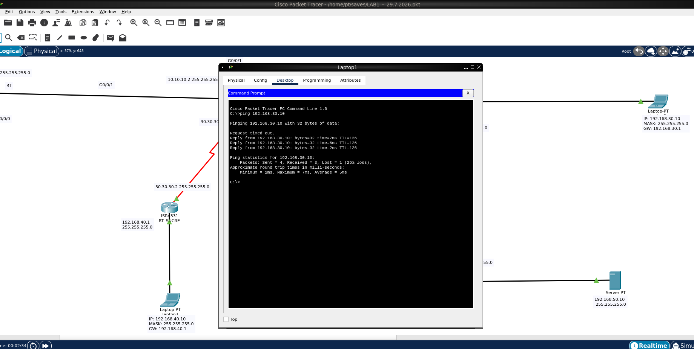

<h1 align="center">Cisco Packet Tracer in Docker</h1>

<p align="center">
  The full Packet Tracer 9.0.1 desktop on a headless server, reachable from any browser.<br>
  <b>noVNC behind HTTP Basic Auth</b> · <b>native VNC</b> · <b>persistent sessions</b> · no X server on the host
</p>

<p align="center">
  <a href="assets/cisco-packet-tracer-docker.png">
    
  </a>
</p>

<p align="center">
  
  
  
  
  
</p>

---

## Quick start

```bash
cp ~/Downloads/CiscoPacketTracer_901_Ubuntu_64bit.deb deb/
cp .env.example .env        # set HTTP_PASSWORD and VNC_PASSWORD
docker compose up -d --build
```

Open <http://localhost:6080/vnc.html> and log in with `HTTP_USER` / `HTTP_PASSWORD`.

- **Browser UI** — nothing to install on the client; works from a tablet.
- **Auth** — Caddy reverse proxy with HTTP Basic Auth (bcrypt) in front of noVNC.
- **Persistence** — labs, preferences and the NetAcad session survive restarts.
- **No FUSE** — the AppImage is extracted at build time, not mounted at runtime.
- **No Cisco software** — you supply the official `.deb` from NetAcad.

| Port | Use |
|------|-----|
| `6080` | **noVNC** — open `http://localhost:6080/vnc.html` |
| `5900` | **Native VNC** — RealVNC/TigerVNC client to `localhost:5900` |

## Prerequisites

- **Docker** with the Compose plugin installed on your system.
- **Cisco Packet Tracer `.deb` package.** You must download the official package
  from the [Cisco Networking Academy website][download] (free NetAcad account).
  **Due to licensing restrictions, this repository cannot provide the Packet
  Tracer software.**

## Instructions

### 1. Download the .deb (NetAcad login, free account)

1. Create a free account at <https://www.netacad.com>.
2. Go to <https://www.netacad.com/resources/lab-downloads?courseLang=en-US> and log in.
3. Download **"Packet Tracer 9.0.1 Ubuntu 64bit"** (a file named
   `CiscoPacketTracer_901_Ubuntu_64bit.deb`). The build is version-agnostic; if
   NetAcad offers a different 9.x, adjust `PT_DEB` in `compose.yml` **and
   regenerate `deb/deb.sha256sum`**.
4. Copy it here:

   ```bash
   cp ~/Downloads/CiscoPacketTracer_901_Ubuntu_64bit.deb ./deb/
   ```

Optional: verify the checksum against the committed manifest.

```bash
sha256sum -c --ignore-missing deb/deb.sha256sum
```

`--ignore-missing` is needed because the manifest lists every version we know
about; it reports only the `.deb` files you actually downloaded.

### 2. Configure (optional)

```bash
cp .env.example .env
# edit .env to set the VNC password or a different desktop resolution
```

- `VNC_PASSWORD=` empty = VNC without a password (local/trusted network only).
- `PUID`/`PGID` = your uid/gid (default `1001`), so the mounted volumes stay writable.
- `HTTP_USER`/`HTTP_PASSWORD` = credentials for the noVNC web interface. With
  `HTTP_PASSWORD` empty, noVNC is served **without authentication**.

### 3. Launch

```bash
docker compose up -d --build
```

### 4. Use

- Browser: <http://localhost:6080/vnc.html> — the `proxy` service puts HTTP Basic
  Auth in front of noVNC, so the browser prompts for a username and password
  (`HTTP_USER` / `HTTP_PASSWORD` in `.env`).
- VNC client: `localhost:5900`
- First run: Packet Tracer asks you to log in with your **NetAcad** account (or use
  the guest login from the dialog). It is remembered afterwards; that session lives
  in `./storage`.
- Persistence: the entrypoint links `~/pt`, `~/.packettracer` and
  `~/.local/share/Cisco Packet Tracer` (cookies / QtWebEngine session) into the
  `./storage` volume, so the session and preferences survive `docker restart`,
  `docker compose down/up` and container recreation.
- Save your labs in `/home/pt/saves` (on the host: `./saves`).

### 5. Logs / diagnostics

```bash
docker compose logs -f                          # general startup
docker exec -it packet-tracer cat /tmp/xvnc.log            # Xvnc
docker exec -it packet-tracer cat /tmp/packettracer.log    # Packet Tracer
docker exec -it packet-tracer cat /tmp/websockify.log      # noVNC
```

## Structure

```
./cisco-packet-tracer-docker/
├── Dockerfile           # build: Qt deps + VNC + noVNC + PT installed
├── entrypoint.sh        # Xvnc + fluxbox + websockify/noVNC + PacketTracer
├── proxy-entrypoint.sh  # Caddy reverse proxy: Basic Auth in front of noVNC
├── compose.yml          # ports 6080/5900, volumes, proxy service
├── .env.example         # PUID/PGID, resolution, VNC_PASSWORD, HTTP Basic Auth
├── assets/              # README screenshot
├── deb/                 # .deb downloaded from NetAcad (you place it here)
│   └── deb.sha256sum    # committed checksum manifest
├── saves/               # .pkt/.pka files you save
└── storage/             # Packet Tracer config/session
```

## License

This repository contains **no Cisco software**. Cisco Packet Tracer is proprietary
software owned by Cisco Systems, Inc., and is governed by Cisco's End User License
Agreement and the Cisco Packet Tracer Supplemental End User License Agreement (SEULA).

- The `deb/*.deb` installers are **not** committed to this repository. Download the
  official build from the [Cisco Networking Academy portal][download] with your own
  (free) NetAcad account and place it in `deb/` before building.
- `deb/deb.sha256sum` **is** committed, so you can verify the file you downloaded.
- The SEULA limits use to network simulations with `.pkt`, `.pkz` or `.pka` files in
  connection with Cisco Networking Academy, unless Cisco approves another purpose
  in writing.
- Cisco Packet Tracer, Cisco and Networking Academy are trademarks of Cisco Systems,
  Inc. This project is not affiliated with, endorsed by, or sponsored by Cisco.

[download]: https://www.netacad.com/resources/lab-downloads
